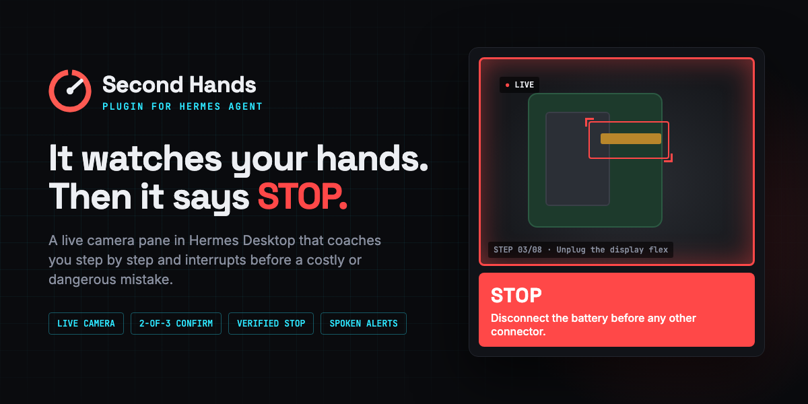
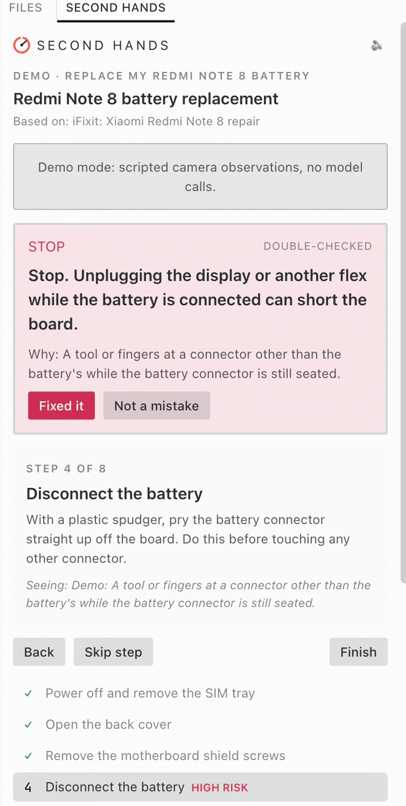
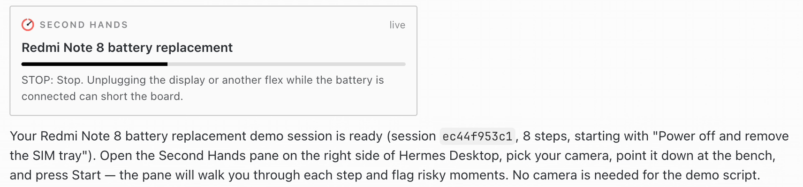
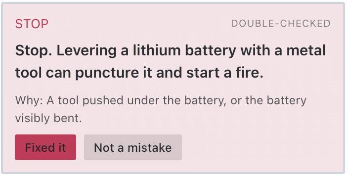
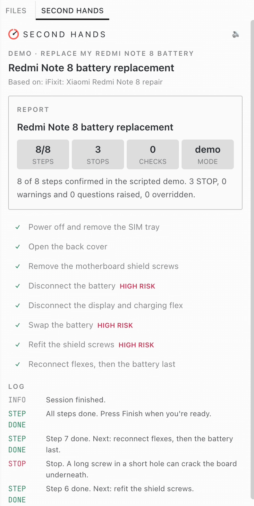
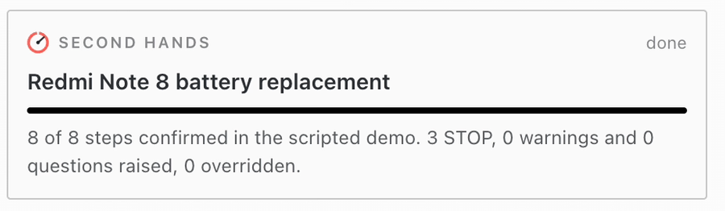

# Second Hands for Hermes



**A second pair of eyes on your hands.** Point a camera at your bench, tell Hermes what you're fixing, building or cooking, and Second Hands watches every step live. Before you make a costly or dangerous mistake, it says **STOP**: out loud, on screen, and in the chat, with the frame that triggered it.

> *"Replace my Redmi Note 8 battery"* → an 8-step guide with the mistakes that matter → a live camera pane in Hermes Desktop → **STOP. Disconnect the battery before any other connector.**

A prompt or a skill can tell you the steps. Only a plugin can **watch you do them**.

[Quick start](#quick-start) · [Screenshots](#screenshots) · [Two ways to use it](#one-idea-two-ways-to-use-it) · [How it works](#how-it-works) · [Disclosure](#disclosure) · [Development](#development)

---

## At a glance

| | |
|---|---|
| 🧭 **Plans the job** | Turns *"swap the battery in my phone"* into 5–10 steps, each with what "done" looks like from above and the visible mistakes worth interrupting for. Four hand-checked guides ship with the plugin; anything else is planned by your model, grounded in a real how-to found with Hermes's own web tools. |
| 👀 **Watches live** | A Hermes Desktop pane with your camera feed (any webcam, or a phone used as one), the current step, a step list, a log and the running cost. Steps confirm themselves when the camera sees them done. |
| ✋ **Stops you, rarely and rightly** | A mistake must show up in **2 of the last 3 frames**, then a fast model decides *warn / ask / stay quiet*, and on high-risk steps a second model **double-checks before any STOP**. Mistake types come from the guide, so the vision model can't invent new alarms. |
| 🔊 **Hands-free** | Alerts are spoken aloud. A status-bar chip shows the step or a red STOP. *Fixed it*, *Not a mistake* (never flag this again on this step), Back, Skip, Finish. |
| 💬 **Part of the conversation** | A live card in the chat, a written report when you finish, and the agent knows where you are: ask *"what step am I on?"* or *"what did I get wrong?"* |
| 🛑 **Knows its limits** | Refuses mains electricity, gas, brakes, airbags and firearms, where a missed warning could seriously hurt someone. |
| 🎬 **Try it in 10 seconds** | `/repair demo <task>` runs scripted camera observations through the real alert pipeline: no camera, no model calls, no cost. |

## Screenshots

| The pane, stopping a mistake | The live card in chat, and a double-checked alert |
|---|---|
|  |   |
|  |  |

*Captured in demo mode (`/repair demo replace my Redmi Note 8 battery`): scripted camera observations through the real alert pipeline.*

## One idea, two ways to use it

Second Hands started as a web app and is now also a Hermes plugin. Same idea, same safety-first alert pipeline (guide-defined mistakes, 2-of-3 confirmation, a second model before any STOP), built for two different places:

| | 🌐 **Second Hands web app** | 🤖 **Second Hands for Hermes** (this repo) |
|---|---|---|
| **Runs in** | Your browser. A phone is the camera, a laptop is the dashboard. | Hermes Desktop, next to your agent |
| **Camera** | The phone's own camera (installable phone app, QR pairing) | Any camera your computer sees, including a phone used as a webcam |
| **Models** | Hosted: NVIDIA Nemotron on Nebius Token Factory | Yours: whatever you've set up in Hermes, on three auxiliary slots |
| **Best for** | Trying it with zero setup, anywhere | Working with your agent: it plans the job, watches it, and remembers what happened |
| **Try it** | [second-hands-seven.vercel.app/try](https://second-hands-seven.vercel.app/try) · [repo](https://github.com/zaxcoraider/second-hands) | [Quick start](#quick-start) below |

## Quick start

**1. Install**

```bash
hermes plugins install second-hands
```

Until the catalog listing is merged, install from the repo instead:

```bash
hermes plugins install https://github.com/zaxcoraider/hermes-second-hands
```

**2. Turn on the pane.** Hermes Desktop → **Capabilities → Plugins** → enable **Second Hands**. Hermes keeps every plugin's Desktop half off until you approve it.

**3. Try the demo** (no camera, no cost): in any chat, type

```
/repair demo replace my Redmi Note 8 battery
```

Open the **Second Hands** pane on the right and press **Start**.

**4. Pick models** (optional). Settings → Models → Auxiliary lists three slots. With nothing set they follow your main model, and the camera slot follows your **vision** slot.

| Slot | Job | Good choice |
|---|---|---|
| `second_hands_vision` | Looks at each frame | A fast vision model, e.g. `nvidia/Nemotron-3.5-Super-VL` |
| `second_hands_fast` | warn / ask / silent, and the spoken line | A small fast model, e.g. `nvidia/Nemotron-3_5-Lightning` |
| `second_hands_plan` | Builds guides, double-checks STOPs, writes the report | Your strongest model |

> [!TIP]
> **Turn thinking off on these slots.** Alerts need speed, not deliberation. For Nemotron on Nebius Token Factory (and other vLLM-served models), `reasoning_effort: "none"` isn't enough; add the model's own switch. It took the gate from 4.8 s to 0.4 s and the camera check from 5.8 s to 1.7 s.

```yaml
auxiliary:
  second_hands_fast:
    provider: nebius-token-factory
    model: nvidia/Nemotron-3_5-Lightning
    extra_body:
      chat_template_kwargs:
        enable_thinking: false
```

**5. Set up the camera.** Any camera macOS, Windows or Linux sees. To use a phone, run it as a webcam (Continuity Camera or Desk View on iPhone, Iriun or DroidCam on Android) and mount it 15–60 cm above the work, facing down, in bright even light.

## Use

```
/repair swap the battery in my Samsung keypad phone
/repair demo dice an onion          # scripted, no camera needed
/repair status
/repair finish
```

Or just ask: *"Help me assemble this flat-pack bookshelf, watch me through the camera."* The agent calls `second_hands_start` (it can research the task first and pass what it found as notes), then shows the live card. Open the pane, choose your camera, press **Start**, and work.

While a session is live, the agent knows the current step, the latest camera observation and any open alert, so short questions work with busy hands: *"what step am I on?"*, *"what did I get wrong?"*

In Desktop, `/repair <task>` and `/repair demo <task>` are sent to the agent as that same request, so the live card always lands in the chat (Desktop shows a plugin command's own reply as plain text). `/repair status` and `/repair finish` stay instant. In the CLI and other surfaces, `/repair` starts the session directly.

## How it works

```
 Camera (Desktop pane) ──frame every 2 s──► plugin_api.py ──► plugin-data/second-hands/
                                                                    │
 Agent tool / /repair ──starts──► worker thread (agent side) ◄──────┘
        │                          observe (vision slot)
        │                          → 2-of-3 confirm (no model)
        │                          → gate: warn / ask / silent (fast slot)
        │                          → verify before STOP (plan slot)
        ▼                                   │
 chat card ::second-hands{…}  ◄── state.json + plugin.second-hands.* events ──► pane, status chip, voice
```

| Piece | What it is |
|---|---|
| `second_hands_start` · `_status` · `_finish` | Agent tools: start a session (with optional research notes), read it live, finish with a report |
| `pre_llm_call` hook | Gives the agent the live step and alert, so it can answer about the session |
| `/repair` | Slash command for start, demo, status and finish |
| `desktop/plugin.js` | The pane, status chip, chat card and the `/repair` route, built only on the Desktop plugin SDK |
| `dashboard/plugin_api.py` | Small REST API the pane uses for frames and controls |
| `engine.py` · `prompts.py` · `guides.json` | The alert pipeline, its prompts, and the four hand-checked guides |

All model calls go through Hermes's `ctx.llm` on the plugin's own auxiliary slots, so Hermes owns provider choice, credentials, fallbacks and the audit log.

## Disclosure

What you should know before installing (catalog rule 13):

- **Network:** the plugin makes **no network calls of its own**. Camera frames (downscaled JPEGs, about every 2 s while a session is live) and step text are sent to **whatever model provider you have configured in Hermes**, through Hermes's `ctx.llm`. The checker always takes the newest frame and skips any that arrived while it was busy, so a 10-minute session is at most about 300 vision calls on your provider's bill (usually far fewer). The pane shows the running cost.
- **Camera:** the Desktop pane opens your camera with the OS permission prompt. It stays on only while the pane is open with an active session, and frames are sent only while a session is live (after **Start**).
- **Files:** reads and writes only `<hermes home>/plugin-data/second-hands/`: session state, the newest frame, and a thumbnail of each frame that triggered an alert. Nothing outside it. Delete the folder to clear history.
- **Background work:** one thread per live session, in the Hermes process that started it. It stops when the session finishes or after 30 idle minutes.
- **Desktop input:** a draft that is exactly `/repair <task>` or `/repair demo <task>` is rewritten into a plain request to the agent (so the live card can appear in its reply). Every other message is passed through unchanged.
- **No** shell commands, no credentials stored or read, no telemetry. Voice uses the OS speech engine locally.
- **Safety:** this is an assistant, not a guarantee. It can miss mistakes. It refuses tasks where a miss could seriously injure someone.

## Development

```bash
git clone https://github.com/zaxcoraider/hermes-second-hands ~/src/hermes-second-hands
ln -s ~/src/hermes-second-hands ~/.hermes/plugins/second-hands
hermes plugins enable second-hands
hermes plugins validate ~/src/hermes-second-hands
```

The Desktop half hot-reloads from a linked checkout. Python changes need a Hermes restart.

## Credits

Built by [zaxcoraider](https://github.com/zaxcoraider) for the Hermes Agent plugin hackathon, from the [Second Hands](https://github.com/zaxcoraider/second-hands) web app (same author). MIT licensed.
